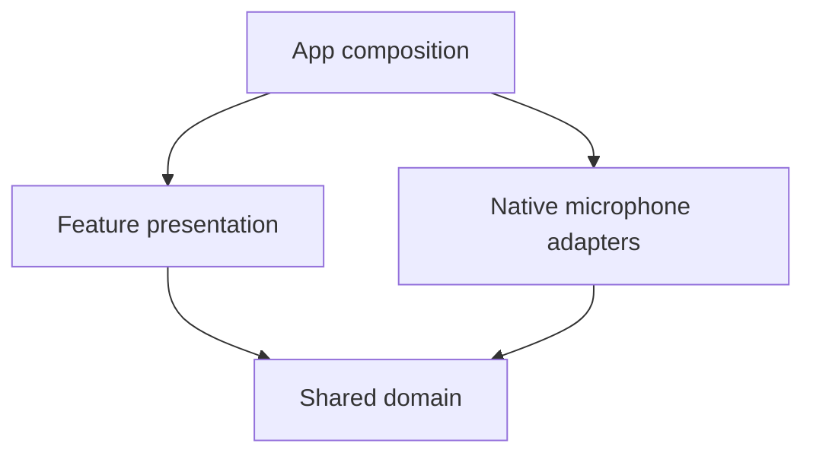

# Feature-based architecture

Code is organized by feature first, then responsibility. The existing feature is `tuner`; future features such as `instrumentconfig` should follow the same structure when implemented. The existing Gradle modules remain unchanged.

## Source map

```text
shared/src/commonMain/kotlin/br/com/gotuner/
  app/TunerFactory.kt
  tuner/
    domain/
      audio/          # YIN detection, capture interfaces, reference tone synthesis and playback port
      model/          # Strings, tuning configuration and results
      tuning/         # Reference selection and cents calculations
    presentation/     # MVVM ViewModel, UI state, observation subscription

androidApp/src/main/kotlin/br/com/gotuner/android/
  MainActivity.kt     # Native entry, permission/lifecycle and dependency setup
  tuner/
    data/             # AudioRecord adapter and AudioTrack tone player
    presentation/
      TunerScreen.kt
      components/     # Reading, verdict and string selector (neck) components

iosApp/
  GuitarTunerApp.swift
  App/AppDependencies.swift
  Features/Tuner/
    Data/             # AVAudioEngine adapter and tone player
    Presentation/
      TunerStore.swift # Native StateFlow/ObservableObject adapter
      TunerScreen.swift
      Components/     # Tuning indicator, verdict, string selector (neck) and listening status
```

The domain layer is shared Kotlin. It contains no platform UI, Android/iOS APIs or presentation dependencies. Data implementations live on the platform that owns microphone capture; there is no empty shared data layer or duplicated native domain layer.

## Dependency boundaries



`AudioSource` defines capture start/stop. `AudioInputObserver` defines sample, permission, listening and failure events. `AndroidAudioRecorder` and `IOSAudioRecorder` consume that domain interface, not a ViewModel. `TunerViewModel` implements the observer and publishes immutable `TunerUiState` values through StateFlow. This permits another consumer or a fake source without tying capture code to presentation.

`TonePlayer` is the output port for the reference tone: `ReferenceTone` synthesizes the samples in the shared domain, and `AndroidTonePlayer` (AudioTrack) and `IOSTonePlayer` (AVAudioEngine) only play them and report when they end. `TunerViewModel` owns string selection, the tuned-string marks and the tone state; while the tone plays it ignores microphone frames. On iOS the recorder and the tone player share one `playAndRecord` session (`TunerAudioSession`), so playing a tone never reroutes the microphone.

`TunerViewModel` receives its `PitchDetector`, `TuningCalculator` and optional `TonePlayer` through its constructor. `TunerFactory` supplies the production defaults. The internal clock constructor supports deterministic hold-duration tests. No DI library, service locator, extra Gradle module or forwarding-only use case was introduced.

On Android, `MainActivity` constructs the shared model and native recorder, handles runtime permission/lifecycle, collects state and passes it to the screen. On iOS, `AppDependencies` constructs the model, recorder and `TunerStore`; the App owns the store with StateObject, and the screen observes it. `TunerStore` owns the cancellable main-dispatcher StateFlow observation and controls capture through `AudioSource`.

## Behavior preserved

The YIN algorithm, frequency smoothing, target selection, accuracy thresholds, 1.5-second hold, worker queues, microphone lifecycle, localized strings, splash artwork and native screen layouts are preserved. This change reorganizes code and replaces implicit construction/capture coupling with explicit dependencies.

## Tests

`shared/src/commonTest/kotlin/br/com/gotuner/tuner` mirrors the production feature:

- `domain/audio/PitchDetectorTest`: signals, harmonics, noise and octave handling.
- `domain/audio/ReferenceToneTest`: pitch of the synthesized tone on every string, level bounds and overtone content.
- `domain/tuning/TuningCalculatorTest`: references, cents, thresholds, unsupported frequencies and the chosen-string target.
- `presentation/TunerViewModelTest`: state publication, quiet/unsupported signals, injected calculator behavior through the audio port, string selection, tuned-string marks and the reference tone through a fake player.
- `AudioFixtures.kt`: common synthetic audio fixtures used only by tests.

Run `./gradlew :shared:jvmTest :androidApp:assembleDebug`. Build the native iOS scheme to validate Swift references and exported Kotlin interfaces as described in README.md.
