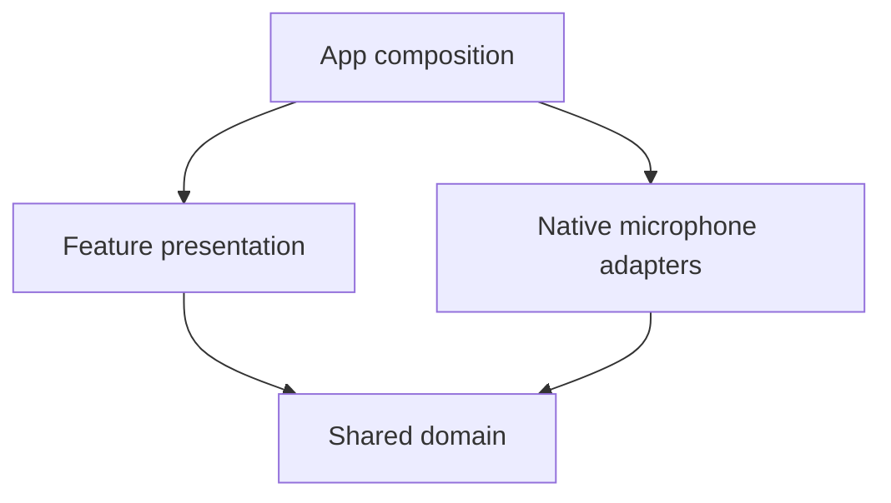

# Feature-based architecture

Code is organized by feature first, then responsibility. The existing feature is `tuner`; future features such as `instrumentconfig` should follow the same structure when implemented. The existing Gradle modules remain unchanged.

## Source map

```text
shared/src/commonMain/kotlin/com/gotuner/
  app/TunerFactory.kt
  tuner/
    domain/
      audio/          # YIN detection and capture interfaces
      model/          # Strings, tuning configuration and results
      tuning/         # Reference selection and cents calculations
    presentation/     # MVVM ViewModel, UI state, observation subscription

androidApp/src/main/kotlin/com/gotuner/android/
  MainActivity.kt     # Native entry, permission/lifecycle and dependency setup
  tuner/
    data/             # AudioRecord adapter
    presentation/
      TunerScreen.kt
      components/     # Tuning indicator and listening status

iosApp/
  GuitarTunerApp.swift
  App/AppDependencies.swift
  Features/Tuner/
    Data/             # AVAudioEngine adapter
    Presentation/
      TunerStore.swift # Native StateFlow/ObservableObject adapter
      TunerScreen.swift
      Components/     # Tuning indicator and listening status
```

The domain layer is shared Kotlin. It contains no platform UI, Android/iOS APIs or presentation dependencies. Data implementations live on the platform that owns microphone capture; there is no empty shared data layer or duplicated native domain layer.

## Dependency boundaries



`AudioSource` defines capture start/stop. `AudioInputObserver` defines sample, permission, listening and failure events. `AndroidAudioRecorder` and `IOSAudioRecorder` consume that domain interface, not a ViewModel. `TunerViewModel` implements the observer and publishes immutable `TunerUiState` values through StateFlow. This permits another consumer or a fake source without tying capture code to presentation.

`TunerViewModel` receives its `PitchDetector` and `TuningCalculator` through its constructor. `TunerFactory` supplies the production defaults. The internal clock constructor supports deterministic hold-duration tests. No DI library, service locator, extra Gradle module or forwarding-only use case was introduced.

On Android, `MainActivity` constructs the shared model and native recorder, handles runtime permission/lifecycle, collects state and passes it to the screen. On iOS, `AppDependencies` constructs the model, recorder and `TunerStore`; the App owns the store with StateObject, and the screen observes it. `TunerStore` owns the cancellable main-dispatcher StateFlow observation and controls capture through `AudioSource`.

## Behavior preserved

The YIN algorithm, frequency smoothing, target selection, accuracy thresholds, 1.5-second hold, worker queues, microphone lifecycle, localized strings, splash artwork and native screen layouts are preserved. This change reorganizes code and replaces implicit construction/capture coupling with explicit dependencies.

## Tests

`shared/src/commonTest/kotlin/com/gotuner/tuner` mirrors the production feature:

- `domain/audio/PitchDetectorTest`: signals, harmonics, noise and octave handling.
- `domain/tuning/TuningCalculatorTest`: references, cents, thresholds and unsupported frequencies.
- `presentation/TunerViewModelTest`: hold duration, state publication, quiet/unsupported signals and injected calculator behavior through the audio port.
- `AudioFixtures.kt`: common synthetic audio fixtures used only by tests.

Run `./gradlew :shared:jvmTest :androidApp:assembleDebug`. Build the native iOS scheme to validate Swift references and exported Kotlin interfaces as described in README.md.
